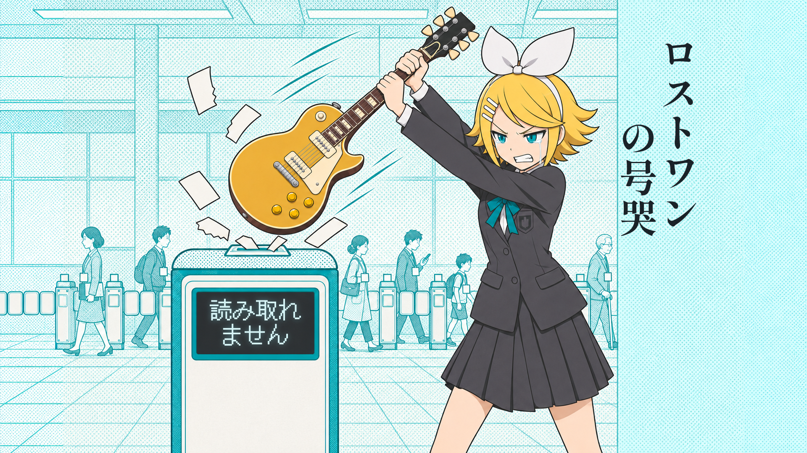
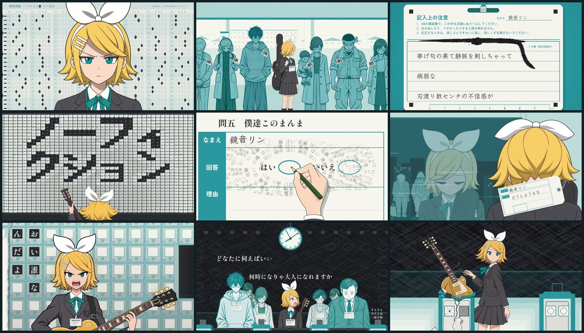
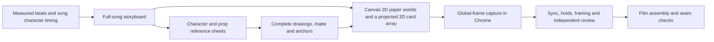

  

<h1 align="center">Lost One's Weeping</h1>

  <b>A fan-made MV for Neru's ロストワンの号哭</b> 
  Everyone in town wears a card that tells the machines who they are. Hers always comes back unreadable.

<a href="README.md">简体中文</a> · English · <a href="README.ja.md">日本語</a>

  Music and lyrics <b>Neru</b> · Vocal <b>Kagamine Rin</b> 
  MV <b>RepressedAlliance × Claude Code (CurlewCornice) × Codex</b>

## Watch

[Bilibili](https://www.bilibili.com/video/BV1yZy3zME2N/) · [YouTube](https://youtu.be/RXiGPd-J26Y) · [X](https://x.com/RepressAlliance/status/2124352839707509122) · 3:33 · 1920×1080 · 30 fps

The town's answer sheets double as name tags. The gates, classrooms and station are printed in teal and graphite. The scanner returns 「読み取れません」, or “Cannot read,” for hers. Rin is in full colour, and the gold of her Les Paul stands out through the film. The lyrics appear inside the world as dot-matrix print, fields on an exam or her own pencil strokes. This is an independent interpretation of the song.

## Making the film

The [making-of guide](docs/guide.en.md) covers the storyboard and card states, how the hand and guitar stay attached across drawings, where the 3D is used, and what changed after review. The [run guide](REPRODUCE.en.md) covers setup, drawing a single frame, resumable rendering and the final checks. You can read the material online to see how this film was made or use the methods as a reference for a different project.

| If you are studying | Start with |
|---|---|
| The links between story, paper and camera | [The full-film structure](docs/guide.en.md#story-and-storyboard) |
| Lyrics that look printed in the scene | [print.js](web/lib/print.js) · [type.js](web/lib/type.js) · [lyrics.js](web/lib/lyrics.js) |
| Moving a drawn figure and a code-drawn part together | [parts.js](web/lib/parts.js) · [card and prop states](docs/guide.en.md#artwork-card-and-props) |
| Combining flat print with 3D depth | [3D and the print treatment](docs/guide.en.md#2d-3d-and-print) · [the fence sequence](web/scenes/segments/seg_09.js) |
| Beat timing and controlled screen motion | [score.js](web/lib/score.js) · [camera.js](web/lib/camera.js) |
| Resumable rendering and shot review | [render_film.py](tools/render_film.py) · [assemble_film.py](tools/assemble_film.py) · [run guide](REPRODUCE.en.md) |

## Credits and licences

- RepressedAlliance directed and reviewed. Claude Code handled storyboards, scene code and compositing. Codex generated the figure and prop drawings from reference sheets. The production session showed the **CurlewCornice** experiment marker and displayed Claude Opus 5.5. The marker documents the experiment observed in the session; it does not identify the underlying model.
- Song by Neru, sung by Kagamine Rin © Crypton Future Media, INC. This is an unofficial, non-commercial fan work. Character usage is subject to the [Piapro Character License](https://piapro.net/pcl/).
- Code uses [MIT](LICENSE). Visual assets and text documentation use [CC BY-NC 4.0](https://creativecommons.org/licenses/by-nc/4.0/), with credit to RepressedAlliance × CurlewCornice. Fonts retain their SIL OFL terms; the clock model is from Poly Haven under CC0. [Model sources](assets/models/SOURCES.md)
- The repo includes the finished cutouts, prompt references, scene code, numerical music and lyric timing and production records. Bring the audio and lyric text for a local run. The song, full lyrics and karaoke ASS are omitted.

[Young Girl A](https://github.com/RepressedAlliance/CurlewCornice-YoungGirlA) · [Kokoro](https://github.com/RepressedAlliance/Fable5.2-Kokoro) · [MeltDown](https://github.com/RepressedAlliance/Opus5.5-MeltDown)
