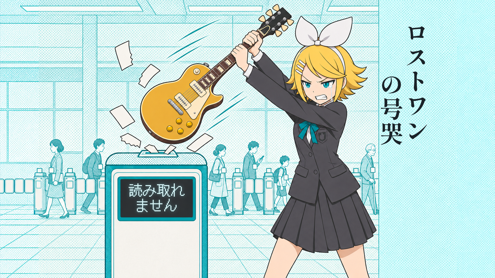
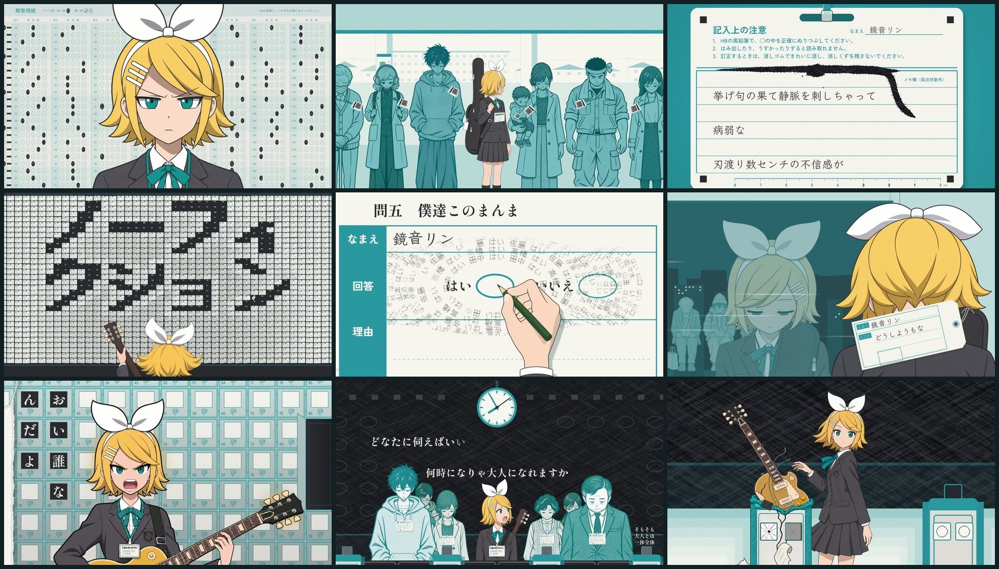
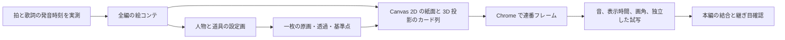

  

<h1 align="center">ロストワンの号哭</h1>

  <b>Neru『ロストワンの号哭』のファンメイド MV</b> 
  誰もが読み取られる町で、彼女のカードだけが読み取れない。

<a href="README.md">简体中文</a> · <a href="README.en.md">English</a> · 日本語

  作詞・作曲 <b>Neru</b> · 歌 <b>鏡音リン</b> 
  MV <b>RepressedAlliance × Claude Code（CurlewCornice）× Codex</b>

## 本編

[bilibili](https://www.bilibili.com/video/BV1yZy3zME2N/) · [YouTube](https://youtu.be/RXiGPd-J26Y) · [X](https://x.com/RepressAlliance/status/2124352839707509122) · 3:33 · 1920×1080 · 30 fps

町の人々はマークシートのような名札を下げています。改札、教室、駅を青緑のインクと黒鉛で描き、彼女だけをカラーで見せました。読み取り機に彼女のカードを差し出すたびに「読み取れません」と印字されます。ギターの金色が物語を通して残り、歌詞はドットの印字、試験用紙、彼女の鉛筆書きとして場面に現れます。楽曲をもとにした独自の解釈です。

## 制作資料

[制作ガイド](docs/guide.ja.md) に全編の構成、カードの状態、人物と道具の合わせ方、3D の使い所、試写後の変更をまとめました。[実行ガイド](REPRODUCE.ja.md) では環境準備、静止画、途中再開できる書き出しと最終確認を説明します。GitHub 上で制作を調べたり、別の作品を作るときに手法を参照したりできます。

| 知りたいこと | 読む場所 |
|---|---|
| 物語と紙面とカメラの関係 | [構成と絵コンテ](docs/guide.ja.md#構成と絵コンテ) |
| 歌詞を印刷や手書きとして見せる | [print.js](web/lib/print.js) · [type.js](web/lib/type.js) · [lyrics.js](web/lib/lyrics.js) |
| 人物の絵と道具を一緒に動かす | [parts.js](web/lib/parts.js) · [人物・カード・道具](docs/guide.ja.md#人物カード道具) |
| 紙面と奥行きを合わせる | [2D・3D と印刷](docs/guide.ja.md#2d3d-と印刷) · [防球ネットの場面](web/scenes/segments/seg_09.js) |
| 拍、カット、揺れすぎないカメラ | [score.js](web/lib/score.js) · [camera.js](web/lib/camera.js) |
| 一枚の確認から全編の出力まで | [実行ガイド](REPRODUCE.ja.md) |

## クレジットと利用条件

- RepressedAlliance は演出と試写、Claude Code は絵コンテ、実装、合成、Codex は設定画に基づく人物と道具の原画を担当。制作セッションに **CurlewCornice** の実験用マーカーがあり、表示は Claude Opus 5.5 でした。マーカーから内部のモデルの詳細は特定できません。
- 原曲は Neru、歌は鏡音リン © Crypton Future Media, INC.。非公式の非営利ファン作品です。[ピアプロ・キャラクター・ライセンス](https://piapro.net/pcl/)
- コードは [MIT](LICENSE)。画面素材と制作文書は [CC BY-NC 4.0](https://creativecommons.org/licenses/by-nc/4.0/) で、クレジットは RepressedAlliance × CurlewCornice。フォントは SIL OFL、Poly Haven の時計モデルは CC0 です。[モデルの出典](assets/models/SOURCES.md)
- 透過原画、プロンプト、場面のコード、時刻表、制作記録を公開しています。音源、完全な歌詞、カラオケ字幕は手元で用意してください。

[少女A](https://github.com/RepressedAlliance/CurlewCornice-YoungGirlA) · [ココロ](https://github.com/RepressedAlliance/Fable5.2-Kokoro) · [炉心融解](https://github.com/RepressedAlliance/Opus5.5-MeltDown)
