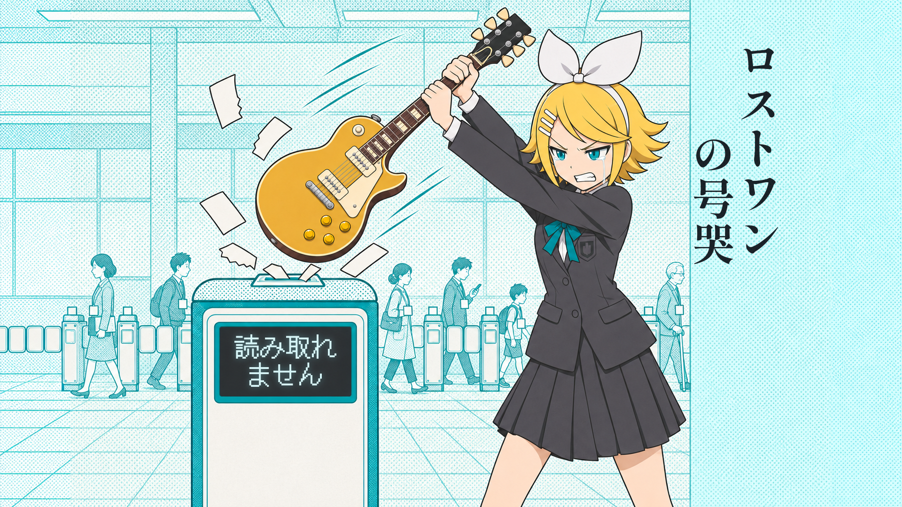
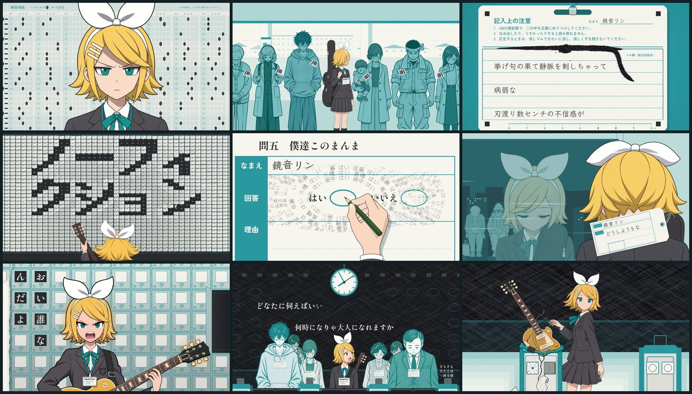
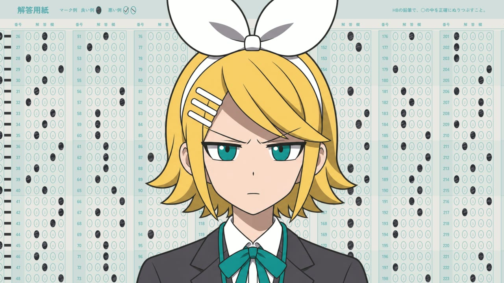
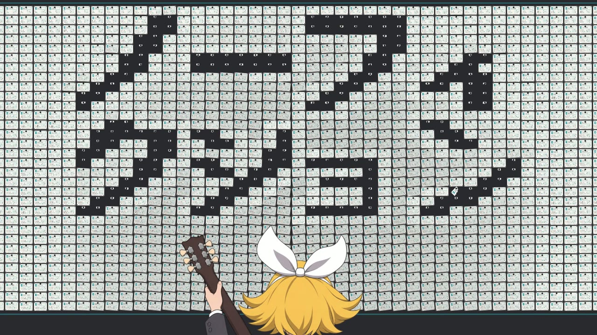
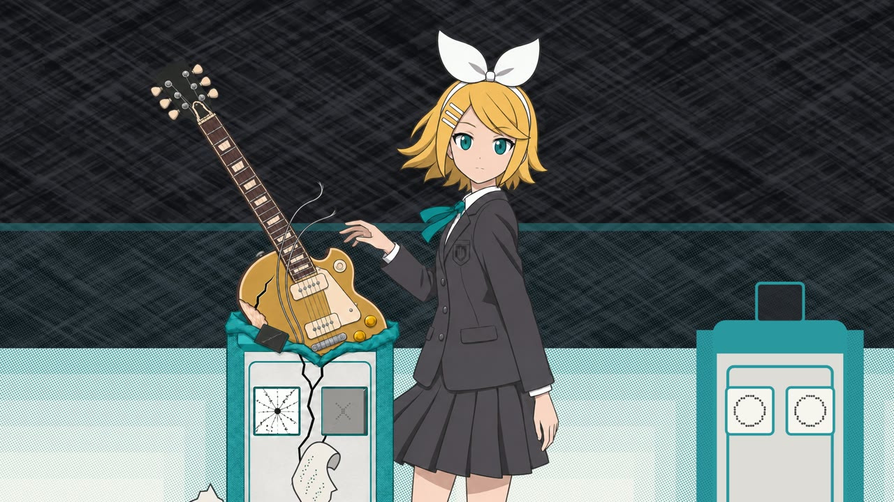
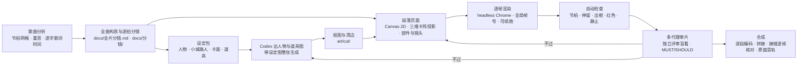

<p align="center">
  
</p>

<h1 align="center">CurlewCornice-LostOnesWeeping</h1>

<p align="center">
  <b>《ロストワンの号哭》同人 MV · 读不出来的她</b><br>
  一座什么都被“读取”的小城，只有她的卡读不出来。
</p>

<p align="center">简体中文 · <a href="README.en.md">English</a> · <a href="README.ja.md">日本語</a></p>

<p align="center">
  
  
  
  
  
  
</p>

<p align="center">
  原曲／作词作曲 <b>Neru</b> · 演唱 <b>鏡音リン</b><br>
  MV <b>压抑同盟 RepressedAlliance</b> × <b>Claude Code（CurlewCornice 灰测）</b> × <b>Codex</b>
</p>

<p align="center">
  <a href="#成片">成片</a> ·
  <a href="#这支片子是怎么做出来的">制作流程</a> ·
  <a href="#运行工程">运行工程</a> ·
  <a href="#做同类作品可以直接借用的部分">可借用的部分</a> ·
  <a href="#关键经验">关键经验</a> ·
  <a href="#关于-curlewcornice">关于 CurlewCornice</a>
</p>

---

## 成片

<p align="center"></p>

| 平台 | 链接 |
|---|---|
| 哔哩哔哩 | [观看](https://www.bilibili.com/video/BV1yZy3zME2N/) |
| YouTube | [观看](https://youtu.be/RXiGPd-J26Y) |
| X | [观看](https://x.com/RepressAlliance/status/2124352839707509122) |

约 3 分 33 秒 · 1920 × 1080 · 30 fps · 全片 6381 帧 · 18 个段落 · 入片人物与道具图 227 张

## 这支片子讲什么

小城里每个人脖子上都挂着一张卡，样子是考试用的答题卡加名牌：碧青色印的格子、定位标记、一排排椭圆，名字、学号、偏差值都用铅笔涂黑。检票口、教室、车站，机器一刻不停地读卡。只有她的卡，读卡机永远只回一句「読み取れません」。

歌词的骨架是一组考题：会考的都答得出，没人考的——那孩子的心、脖子上的绳、小时候的梦——一道也答不上。唯一的武器是吉他。片子从答题纸一路走到检票口、楼梯、防球围网、深夜车站，最后她把吉他砸进了读卡机。

**视觉规则：** 小城和路人全部是碧青单色印刷加铅笔黑，只有她是全彩；全片不用红色（避开原版 PV 的色彩语言）；歌词不做字幕条，而是画面里的东西——读卡机的点阵字、答题纸上的印刷字、她的铅笔字。

这是本片的同人诠释，不代表原作者的意图。

<table>
  <tr>
    <td width="33%"></td>
    <td width="33%"></td>
    <td width="33%"></td>
  </tr>
  <tr>
    <td align="center"><sub>开场：读不出来的卡</sub></td>
    <td align="center"><sub>riff：点阵印出的「ノーフィクション」</sub></td>
    <td align="center"><sub>结尾：吉他砸进读卡机</sub></td>
  </tr>
</table>

## 这支片子是怎么做出来的



1. **先听懂歌，再定画面。** `tools/analyze_audio.py`、`beat_grid.py`、`beat_accents.py` 从音频得到 162 BPM 的节拍网格、小节和底鼓/军鼓重音；`lyric_times.py` 把卡拉 OK 逐字轴对齐到人声分轨，得到每个字真正开口的时间。之后所有画面事件都登记在这张时间表上。
2. **逐拍分镜。** 每段一份分镜文档（`docs/分镜/`），写清“观众该看到、感到的”、每一拍发生什么、用哪张图、镜头怎么走、风险和对策。全片帧表由段落注册表 `web/segments.json` 生成，帧 g 永远显示歌曲第 g/30 秒。
3. **设定先行。** `docs/设定包.md` 和 `art/canon/` 固定铃的官方基础设定（碧青色眼、金发、152 cm）、小城路人、卡面、读卡机、吉他等。
4. **人物图由 Codex 整张生成。** 每个镜头按机位、动作、情绪出新图，带设定图作参考；差分从同一张母版改一处，避免换张时忽胖忽瘦。代码只负责抠图、对齐、摆放和动画，不拼贴人物像素。提示词全部在 `art/design/prompts/`。
5. **网页 canvas 逐帧画。** 每段是一个页面模块（`web/scenes/segments/seg_XX.js`），用共用库画答题纸、卡面、读卡机、点阵字、网点印刷和镜头运动。页面暴露 `renderAt(t)`，渲染器 `web/render_film.mjs` 在 headless Chrome 里按全局帧号逐帧截图，可以断点续跑、只重渲改动过的段。
6. **自动检查 + 多代理审片。** 页面在渲染时自报 BEAT AUDIT（事件是否落在实测拍点）、HOLD AUDIT（每张图停够没有、有没有 A→B→A）、SCALE AUDIT（位图放大倍率）；工具再扫红色、静止、出框、部件是否跟着人物走。然后由没参与制作的评审代理盲看审片，给出 MUST/SHOULD，修改方按根因修、全片同类一起修（`work/workflows/`）。
7. **合成。** `tools/assemble_film.py` 每段单独高质量编码，按注册表顺序拼接，接入原曲，并在每个接缝逐帧核对画面和音画同步。

## 运行工程

分镜、代码和素材都可以直接在 GitHub 上看，用来研究这支片怎么做，也可以给自己的作品找参考。想实际运行工程，见[运行指南](REPRODUCE.md)。最短路径如下。

```powershell
# 1. 环境：Windows 11（其他系统需改 Chrome 路径）、Node 24、Python 3.12、FFmpeg、Google Chrome
git clone https://github.com/RepressedAlliance/CurlewCornice-LostOnesWeeping.git
cd CurlewCornice-LostOnesWeeping
Push-Location web
npm install
Pop-Location
python -m pip install -r requirements.txt

# 2. 自备歌曲和歌词（不随仓库分发）
#    input/song.flac                原曲（214.27 秒的发行版，时间轴以它为准）
#    lyrics.txt                     一行一句、按演唱顺序的歌词
python tools/lyrics_fill.py lyrics.txt      # 生成 work/audio/lyrics_timed.json

# 3. 渲染并合成
python tools/segments.py check
python tools/render_film.py run --jobs 6
python tools/assemble_film.py --out work/full/film.mp4
```

只想研究方法，直接读 `docs/` 和代码即可，不需要渲染；只想看一帧，用 `node web/preview.mjs`（见 REPRODUCE.md）。

## 做同类作品可以直接借用的部分

| 你要做的 | 可以借用 | 位置 |
|---|---|---|
| 画面卡在节拍上 | 拍点表、事件登记、BEAT AUDIT、换张停留检查（HOLD AUDIT、A→B→A） | [web/lib/score.js](web/lib/score.js) |
| 歌词逐字出现、和演唱对齐 | 逐字时间表加载、按行取字、开口那一帧就读得出 | [web/lib/lyrics.js](web/lib/lyrics.js)、[tools/lyric_times.py](tools/lyric_times.py) |
| 日文排版不超框 | 先量再放、自动缩进框、竖排、版面登记与重叠检查 | [web/lib/type.js](web/lib/type.js) |
| 代码部件跟着人物图走 | 笔、琴弦、颈绳等部件按每张图的锚点同一变换 | [web/lib/parts.js](web/lib/parts.js)、[web/lib/hand.js](web/lib/hand.js) |
| 印刷质感 | 网点、套色、碧青单色印刷、铅笔排线 | [web/lib/print.js](web/lib/print.js)、[web/lib/palette.js](web/lib/palette.js)、[web/lib/toon.js](web/lib/toon.js) |
| 镜头运动有节奏但不晕 | 台阶推镜、冲击与回弹的上限；整屏运动拟合与统计 | [web/lib/camera.js](web/lib/camera.js)、[work/rhythm_diag/](work/rhythm_diag/) |
| 网页逐帧出片 | headless Chrome 渲染器（全局帧号、可续跑、依赖哈希）、分块并行、看门狗 | [web/render_film.mjs](web/render_film.mjs)、[tools/render_film.py](tools/render_film.py)、[tools/watch_jobs.py](tools/watch_jobs.py) |
| 批量出人物图 | Codex 出图任务表与并行批跑 | [tools/make_jobs.py](tools/make_jobs.py)、[tools/gen_batch.ps1](tools/gen_batch.ps1)、[tools/gen.ps1](tools/gen.ps1) |
| 抠图与清边 | 去背景、去色边、补洞、去网点 | [tools/cutout.py](tools/cutout.py)、[tools/defringe.py](tools/defringe.py)、[tools/edge_clean.py](tools/edge_clean.py)、[tools/descreen.py](tools/descreen.py) |
| 出片前自动查错 | 红色扫描、静止扫描、出框、差分对母版、人物图复用表、审片拼图 | [tools/red_scan.py](tools/red_scan.py)、[tools/static_scan.py](tools/static_scan.py)、[tools/bleed_check.py](tools/bleed_check.py)、[tools/swap_check.py](tools/swap_check.py)、[tools/reuse_audit.py](tools/reuse_audit.py)、[tools/review_sheets.py](tools/review_sheets.py) |
| 让多个代理分工制作和审片 | 逐段制作 → 独立评审 → 按 MUST 修改 → 复审的工作流 | [work/workflows/](work/workflows/) |
| 合成与接缝核对 | 逐段编码、拼接、接缝逐帧比对、音画同步检查 | [tools/assemble_film.py](tools/assemble_film.py) |

## 目录结构

```text
web/
  scenes/segments/   18 个段落页面（seg_00 … seg_16），每段一个 renderAt(t)
  scenes/sheet.html  所有段落共用的页面外壳（?page=seg_XX）
  lib/               共用库：节拍、歌词、排版、部件、印刷、镜头、卡面、读卡机……
  render_film.mjs    headless Chrome 逐帧渲染器
  preview.mjs        单帧预览
  segments.json      段落注册表：帧范围、页面、状态
tools/               音频分析、Codex 出图、抠图、渲染调度、合成、各类检查
art/
  canon/             设定图（人物三视图、表情、卡面、读卡机、吉他……）
  cut/               入片的人物与道具图（已抠图）
  design/prompts/    全部 Codex 提示词与共用画风文本
  design/jobs/       出图任务表（记录每一批用了哪些提示词和参考图）
  ref/ props/        卡面母版、作文道具等参考
assets/              字体（SIL OFL）与 CC0 三维模型
docs/
  阶段1-全曲构思.md   这首歌怎么理解、片子做成什么样
  全片分镜.md         全片结构与每段看点
  分镜/               每段逐拍分镜、帧表、拍号对照
  设定包.md           人物、路人、道具设定
  制作约定.md         全片规则：画面语言、人物、节奏、文字、镜头、工程、交付关卡
  交付检查清单.md     每段交付前逐条过的清单
  经验与检查清单.md   问题类型 → 成因 → 检查方法
work/
  workflows/         多代理工作流脚本
  rhythm_diag/       节奏诊断与整屏运动统计脚本
  seg/*/             各段的测量与检查脚本
  audio/             节拍网格、重音、歌词时间（不含歌词文字）
```

## 关键经验

完整的问题清单在 [docs/经验与检查清单.md](docs/经验与检查清单.md)，规则在 [docs/制作约定.md](docs/制作约定.md)。最值得带走的几条：

- **每个问题都是一类问题的样本。** 修一处之前先查成因，再在全片找同类，改成因。清单的三列就是“问题类型 → 成因 → 检查方法”，检查方法直接变成下一段的自检项。
- **先好看，再无错。** 一个本身不抓人的片段，修到完全没错也没有用。每段先静音盲看判断“值不值得看”，不过就重新设计，挑错只是底线。
- **人物图整张生成，不拼像素。** 图不合用就带参考图重画；差分出自同一张母版、只改一处；人物视角和机位一致，平视画的人物只配水平机位。
- **一切落在实测拍点上。** 切镜、换张、镜头起止、印字都登记时间并自动检查；画面不提前；每张图停够两拍以上，中间张只在需要处补。
- **歌词在开口那一帧就读得出。** “出现”指能读出来，不是开始淡入；淡入曲线从开口那一帧起算会让全片平均晚 1–2 帧，正好在人能察觉的界线上。
- **有节奏感，但不晕。** 整屏冲击是强刺激，按段限次、设上限；动感主要来自切镜、换张、画里东西的冲击和平稳的推拉。
- **代码画的部件要跟着人物图走。** 笔芯、琴弦、颈绳这类部件按每张图各自的锚点做同一个变换，换张时一起换，否则一眼就能看出“不是一块的”。
- **3D 不歪。** 镜头不转斜、竖线竖直、中长焦、卡阵整齐；激烈靠剪辑和换张，不靠歪镜头。
- **让没参与制作的代理来审。** 制作方自审之后，再由独立评审盲看，给出必须改（MUST）和建议改（SHOULD），修改后复审，直到没有 MUST。

## 关于 CurlewCornice

本片的 Claude Code 制作会话出现了 **CurlewCornice** 灰测标记，工具界面显示 Claude Opus 5.5。具体使用的底层模型无法从标记确认。同系列的上一部作品是[《少女A》](https://github.com/RepressedAlliance/CurlewCornice-YoungGirlA)。

## 署名与版权

- **原曲：** 《ロストワンの号哭》，作词作曲 Neru。**演唱：** 鏡音リン（© Crypton Future Media, INC. www.piapro.net）。
- 本作品是**非官方的同人二次创作**，与原作者、Crypton Future Media 及发行方无关，不以营利为目的。
- **AI 生成内容声明：** 人物与道具图由 Codex 的图像生成功能按本仓库的提示词和设定图生成；分镜、代码、排版与合成由 Claude Code（CurlewCornice）在人工指导下完成。
- **不随仓库分发：** 歌曲音频、歌词全文、卡拉 OK 字幕。`work/audio/lyrics_timing.json` 只含逐字时间和字数，运行工程时请自行准备合法来源的音频和歌词。
- 第三方素材：字体为 SIL Open Font License（Klee One、Shippori Mincho、Zen Kaku Gothic New、Zen Kurenaido、DotGothic16、Yomogi），挂钟模型来自 Poly Haven（CC0），见 [assets/models/SOURCES.md](assets/models/SOURCES.md)。

## 许可证

- **代码**（`web/`、`tools/`、`work/` 下的脚本等）：[MIT](LICENSE)。
- **画面素材**（`art/`、`docs/media/`）和成片画面：[CC BY-NC 4.0](https://creativecommons.org/licenses/by-nc/4.0/)，署名“压抑同盟 RepressedAlliance × CurlewCornice”，不可商用。素材中的鏡音リン形象另受 Crypton Future Media 的角色使用条款约束（[piapro Character License](https://piapro.net/pcl/)）。
- **文档**（`docs/` 下的文字）：CC BY-NC 4.0。
- 字体和三维模型保留各自的许可证。

## 相关项目

- [CurlewCornice-YoungGirlA](https://github.com/RepressedAlliance/CurlewCornice-YoungGirlA)：《少女A》同人 MV，Skia 二维 + Blender 三维 NPR 管线。
- [Fable5.2-Kokoro](https://github.com/RepressedAlliance/Fable5.2-Kokoro)：《ココロ》同人 PV。
- [Opus5.5-MeltDown](https://github.com/RepressedAlliance/Opus5.5-MeltDown)：《炉心融解》同人 MV。
